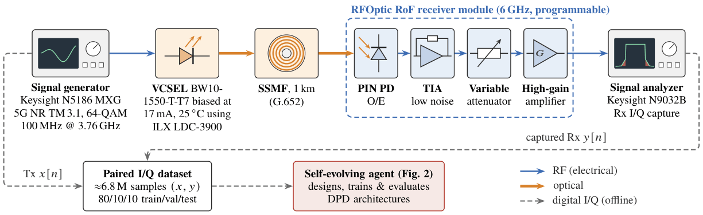

# Self-Evolving Agent-Discovered Low-Complexity Neural Architectures for Digital Predistortion in Analog Radio-over-Fiber Systems

This repository contains the digital predistortion (DPD) models discovered by a
self-evolving LLM agent for a 5G analog radio-over-fiber link, along with the
initial seed models the search started from.



## Repository structure

```
discovered/   DPD models written by the agent during the search
seeds/        Starting models (KAN, MLP, CNN, GMP, linear FIR)
```

## Models reported in the paper

| Model | Description | RM |
|---|---|---|
| `seeds/seed_kan.py` | KAN 3–8–2 on [I, Q, p] of the center sample + 2×2 linear path | 244 |
| `seeds/seed_mlp.py` | MLP 3–16–16–2 (ReLU) on [I, Q, p] + skip connection | 336 |
| `discovered/D-103.py` | 11-tap decimated complex FIR × power-scaled KAN envelope gain | 248 |
| `discovered/D-097.py` | linear path + 7-tap complex FIR + power-gated KAN correction | 362 |
| `discovered/D-008.py` | power-conditioned mixture of four MLP experts over 21 taps | 6150 |

D-097 is the agent's design with the KAN hidden width reduced from 8 to 6 and
the FIR lengthened from 5 to 7 taps, giving the complexity reported in the paper.

## Complexity convention

RM is the number of real multiplications per output sample.

- A complex weight costs 4 RM and a real weight costs 1 RM.
- A KAN edge costs k + 3 RM, where k is the spline order (k = 3 here), independent of grid size.
- Complexity of KAN is calculated in accordance with the paper "Hardware-oriented inference complexity of Kolmogorov-Arnold Networks" (IEEE Access)
- Element-wise operations (activations, gating products) are not counted.

## Dependencies

The models are built from a small set of layer primitives (`RLinear`, `CLinear`,
`KANLayer`, …) imported from `eqdgm.dpd.primitives`, with the base class from
`eqdgm.dpd.interface`. Python ≥ 3.10 and PyTorch ≥ 2.0 are required.

## Citation

If you use these models, please cite:

```bibtex
@inproceedings{khalid2027agentdpd,
  author    = {Khalid, Bilal and others},
  title     = {Self-Evolving Agent-Discovered Low-Complexity Neural Architectures for Digital Predistortion in Analog Radio-over-Fiber Systems},
  booktitle = {Submitted to Optical Fiber Communication Conference (OFC)},
  year      = {2026}
}
```
